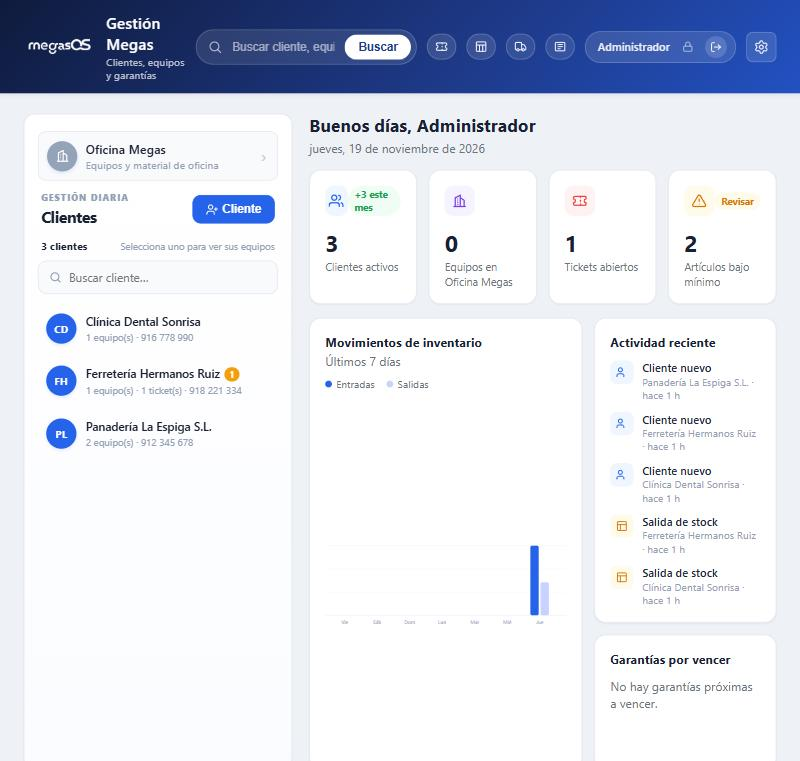

# Control de Equipos (megasOS)

Aplicación de gestión para un taller de reparación: clientes, sus equipos,
historial de intervenciones, tickets de reparación e inventario de piezas.
Node.js + Express + SQLite en el backend, JavaScript vanilla en el frontend
— sin frameworks pesados ni build step, pensada para correr en un PC
cualquiera del taller.



## Arrancar en desarrollo

```bash
npm install
npm start
```

La app queda escuchando en `http://localhost:4000`. En el primer arranque se
crea automáticamente una base de datos vacía con un único usuario de
demostración:

- **Usuario:** `Demo`
- **Contraseña:** `Demo1234`

(cámbiala cuanto antes desde Configuración → Usuarios si vas a usarlo más
allá de echar un vistazo).

## Generar el ejecutable portable

```bash
npm run build:exe
```

Genera `dist/ControlEquipos.exe`: un único archivo que no necesita Node
instalado en la máquina destino. Ver
[docs/01-arquitectura.md](docs/01-arquitectura.md#empaquetado-como-ejecutable--yao-pkgpkg)
para el porqué, y el `.exe` resultante crea su propio `data.sqlite` junto a
sí mismo la primera vez que arranca.

## Documentación

Toda la documentación técnica está en [`docs/`](docs/README.md):

- [Arquitectura](docs/01-arquitectura.md)
- [Pantallas](docs/02-pantallas.md)
- [Base de datos](docs/03-base-de-datos.md)
- [API](docs/04-api.md)
- [Cómo se ha desarrollado](docs/05-historial-desarrollo.md)

## Sobre los datos de este repositorio

Este repositorio **no incluye ninguna base de datos**: `data.sqlite` se
genera la primera vez que se arranca, con el único usuario `Demo` descrito
arriba y un cliente de ejemplo ("Bar El Rincón") con un equipo, un ticket
y un artículo de inventario, todos ficticios, para que se pueda ver la app
funcionando sin partir de cero. Ya está excluido en `.gitignore`, junto con
`uploads/`, `node_modules/` y `dist/`, así que tampoco se genera por
accidente al hacer commit. Las capturas de `docs/screenshots/` se generaron
aparte, con datos de ejemplo ficticios, nunca con datos reales de clientes.
