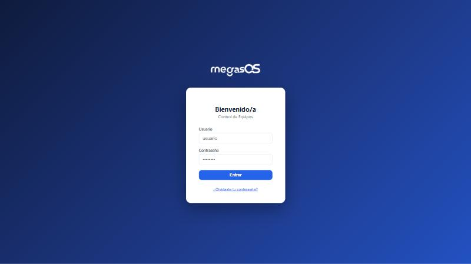
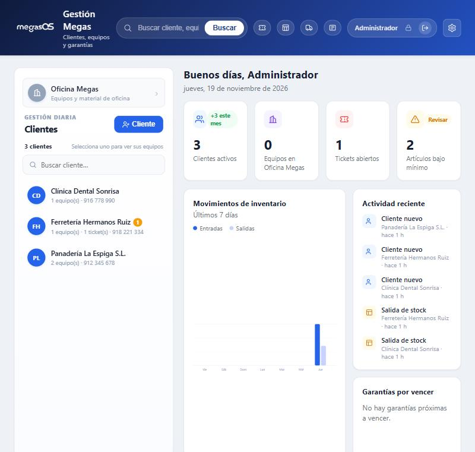
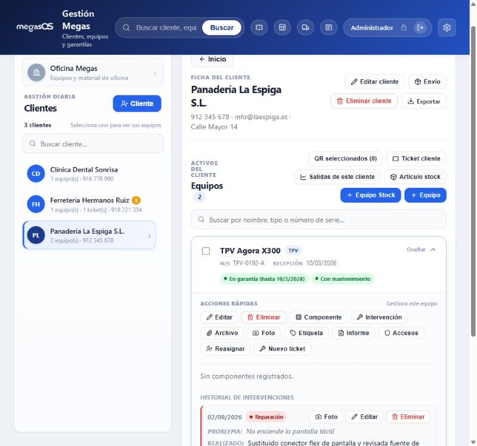
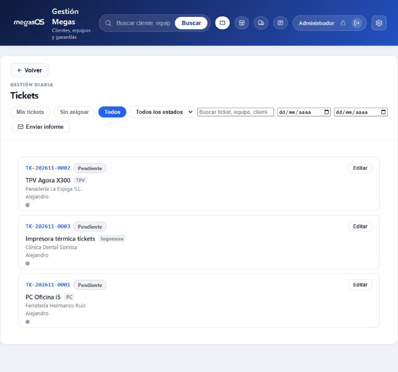
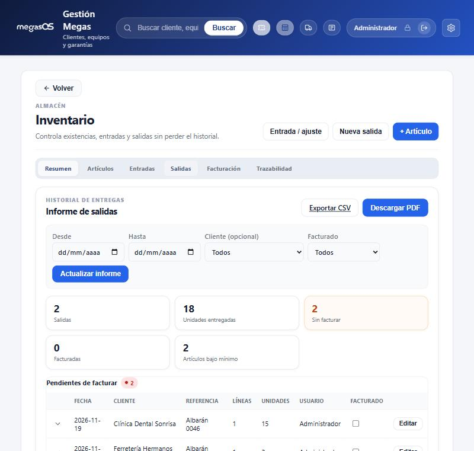
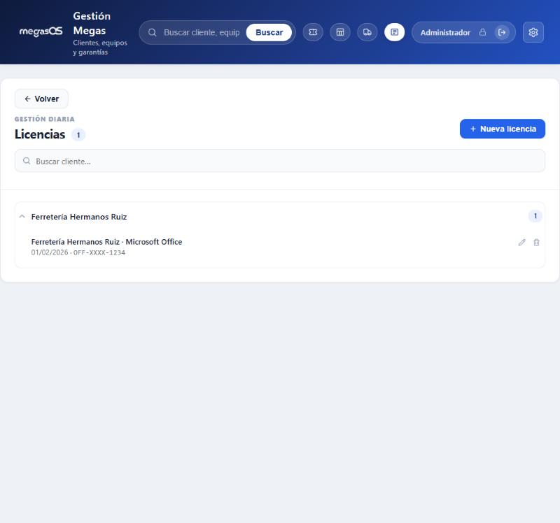
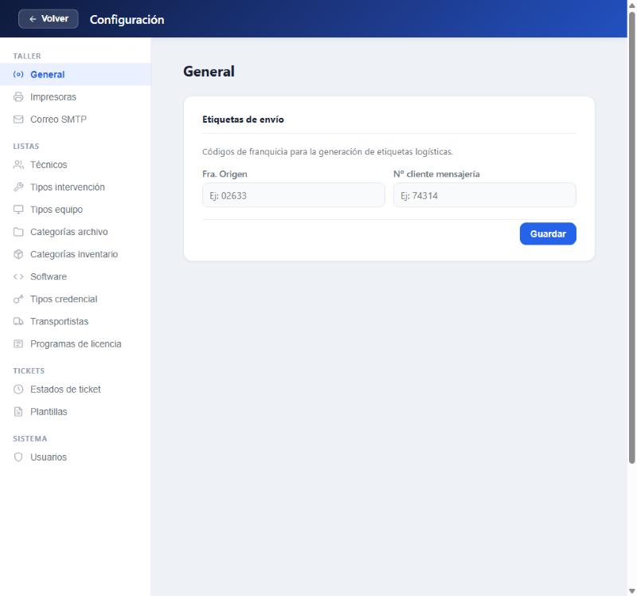

# Pantallas

La app es multipágina: cada pantalla de esta guía es una ruta real servida
por `server.js`, con su propio HTML y su propio JS en
`public/pages/<sección>/` (ver [01-arquitectura.md](01-arquitectura.md)).
Esta guía explica qué hace cada una y dónde está su código.

> Las capturas son de una copia de pruebas con datos de ejemplo (no datos
> reales de clientes), generada solo para esta documentación.

## 1. Inicio de sesión

Ruta `GET /login` → `public/pages/login/`. Pantalla de acceso con
usuario/contraseña; `POST /api/login` crea la sesión y redirige a `/`. El
middleware `pageGuest` evita que un usuario ya logueado vuelva a ver esta
página (lo manda a `/`), igual que `pageAuth` hace lo contrario en el resto
de rutas. Incluye recuperación de contraseña por email (`#modal-recuperar-pass`
→ `POST /api/solicitar-reset` → enlace de un solo uso en
`GET/POST /reset/:token`).

## 2. Inicio (dashboard)

Ruta `GET /` → `public/pages/inicio/`. Pinta el dashboard con datos de
`GET /api/dashboard`; comparte plantilla y sidebar de clientes con la ficha
de cliente (ver siguiente sección). Es la pantalla que se ve nada más entrar
(y al pulsar el logo). Resume de un vistazo:

- Clientes activos (con variación de altas este mes).
- Equipos en Oficina Megas (material propio, sin cliente asignado).
- Tickets abiertos (con cerrados hoy).
- Artículos de inventario bajo el stock mínimo.
- Gráfico de entradas/salidas de inventario de los últimos 7 días.
- Actividad reciente (tickets cerrados, clientes nuevos, salidas de stock).
- Garantías que vencen pronto.

Todos los números son reales, calculados con SQL sobre las mismas tablas que
usa el resto de la app — no hay cifras inventadas ni animadas.

Hay una versión de esta misma pantalla, recreada en Figma a partir del HTML
real, en: https://www.figma.com/design/TmditadFowo5Xhdoq3vIG3

## 3. Clientes y ficha de cliente

Ruta `GET /clientes/:id` (y `GET /oficina` para los equipos sin cliente
asignado) → `public/pages/ficha/`. Barra lateral de clientes + panel de
detalle; al entrar se cargan sus equipos (`GET /api/clientes/:id` +
`GET /api/clientes/:id/equipos`). Desde aquí se gestiona todo lo que cuelga
de un cliente:

- **Equipos**: tipo (PC, Portátil, Tablet…), nº de serie, fecha de
  recepción/garantía, mantenimiento, cargador/teclado (solo Tablet), y
  **batería** — si el equipo tiene el campo "Vida batería (%)" relleno, se
  muestra un badge de color (verde ≥80 %, ámbar 50-79 %, rojo &lt;50 %) justo
  debajo del software instalado, para verla de un vistazo.
- **Componentes** de cada equipo (piezas internas con su propio nº de serie).
- **Historial de intervenciones** (reparaciones, revisiones, con coste y
  técnico).
- **Archivos adjuntos** (facturas, presupuestos…) y **fotos**.
- **Accesos** (credenciales de AnyDesk/Megas/usuario-contraseña, licencias de
  software) — pensado para que el técnico tenga a mano cómo entrar a un
  equipo remoto.
- Exportar la ficha completa a PDF/Excel/CSV, o generar una etiqueta de envío.

"**Oficina Megas**" (arriba del todo en la barra lateral) es un
cliente especial: equipos y material que son propiedad del propio taller, sin
asignar a ningún cliente externo.

## 4. Tickets

Ruta `GET /tickets` → `public/pages/tickets/`, con sus propias rutas
`GET/PUT/DELETE /api/tickets*`. Es el
flujo de reparación: cada ticket tiene un estado configurable (por defecto
Pendiente → Diagnóstico → En reparación → Esperando piezas → Listo →
Entregado/Cerrado), técnico asignado, coste, horas trabajadas, y un
**log de cambios** (`ticket_log`) que registra quién cambió qué y cuándo.
Permite filtrar por "Mis tickets", sin asignar, por cliente, por fechas, y
enviar un informe por email. Al marcar un ticket como "Listo" se puede avisar
automáticamente al cliente por correo.

## 5. Inventario

Ruta `GET /inventario` → `public/pages/inventario/`. Gestión de stock de
piezas/consumibles (cargadores, tornillería, etc.), separada de los
"equipos" de cliente:

- **Artículos**: nombre, categoría, stock actual, stock mínimo (de ahí sale
  el KPI "Artículos bajo mínimo" de Inicio), código/EAN.
- **Movimientos**: toda entrada, salida o ajuste de stock queda auditada en
  `inventario_movimientos`, con stock anterior/nuevo — nunca se sobrescribe
  el stock sin dejar rastro.
- **Salidas**: se pueden agrupar por cliente (p. ej. "le llevamos 3
  cargadores a Ferretería Soto"), editarse o borrarse después de creadas, y
  marcarse como "Facturado" (lo que las mueve de la lista de pendientes a la
  de facturadas). Cada fila se puede desplegar para ver qué artículos
  contenía.
- **Informe de salidas**: genera un PDF o lo envía por correo (con el logo
  del taller incrustado) con los movimientos de un rango de fechas. Incluye
  un apartado "Pedir" donde se eligen con casillas qué artículos bajo stock
  mínimo encargar, más una caja de texto libre y un buscador para añadir
  cualquier otro artículo a mano.
- Importación de artículos, búsqueda por EAN, trazabilidad completa.

## 6. Envíos

Ruta `GET /envios` → `public/pages/envios/`, con rutas
`GET/POST/PUT/DELETE /api/envios`. Registro de paquetería saliente
(envíos a clientes/proveedores) y entrante (devoluciones), con
transportista y número de seguimiento; permite generar un informe en PDF
filtrado por tipo y rango de fechas.

## 7. Licencias

Ruta `GET /licencias` → `public/pages/licencias/`, con rutas
`GET/POST/PUT/DELETE /api/licencias`. Registro de licencias de software por
cliente (nombre del programa, clave, fecha de alta) independiente de las
"licencias" que se pueden anotar dentro de los Accesos de un equipo —
pensado para software que no está ligado a un equipo concreto (p. ej. un
paquete ofimático con varios puestos).

## 8. Configuración

Ruta `GET /configuracion` → `public/pages/configuracion/`, con un menú
lateral de pestañas (`data-pane="..."`) que decide qué listas y ajustes son
solo de administrador:

| Grupo | Pestañas |
|---|---|
| Taller *(admin)* | General (etiquetas de envío), Impresoras, Correo SMTP |
| Listas | Técnicos, Tipos de intervención, Tipos de equipo, Categorías de archivo, Categorías de inventario, Software, Tipos de credencial |
| Tickets | Estados de ticket *(admin)*, Plantillas de intervención |
| Sistema | Usuarios *(admin)* |

Casi todas estas "listas" (tipos de equipo, estados de ticket, categorías…)
son configurables sin tocar código: se guardan en la tabla `configuracion`
como JSON y alimentan los `<select>` de toda la app.

## Otras piezas de la interfaz (no son paneles de página completa)

- **Búsqueda global** (lupa de la barra superior): `GET /api/buscar`, busca
  por cliente, equipo o número de serie en toda la base de datos a la vez.
- **Etiquetas/QR de equipo**: cada equipo puede imprimir una etiqueta con QR
  que enlaza a `/equipo/:id`, una ficha pública minimalista pensada para
  pegar físicamente en el aparato.
- Decenas de modales (`<dialog>`) para cada acción puntual: nuevo
  cliente/equipo/componente, subir foto/archivo, nueva intervención, accesos,
  cambiar contraseña, etc. Cada modal vive en el HTML de la página que lo usa
  (algunos, como el de ticket o el de cambiar contraseña, se repiten tal cual
  en varias páginas — ver la nota sobre páginas autocontenidas en
  [01-arquitectura.md](01-arquitectura.md)).
